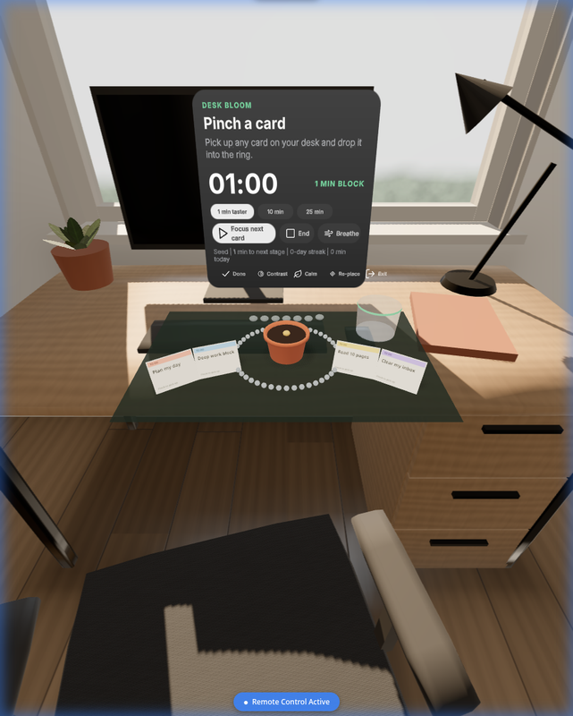
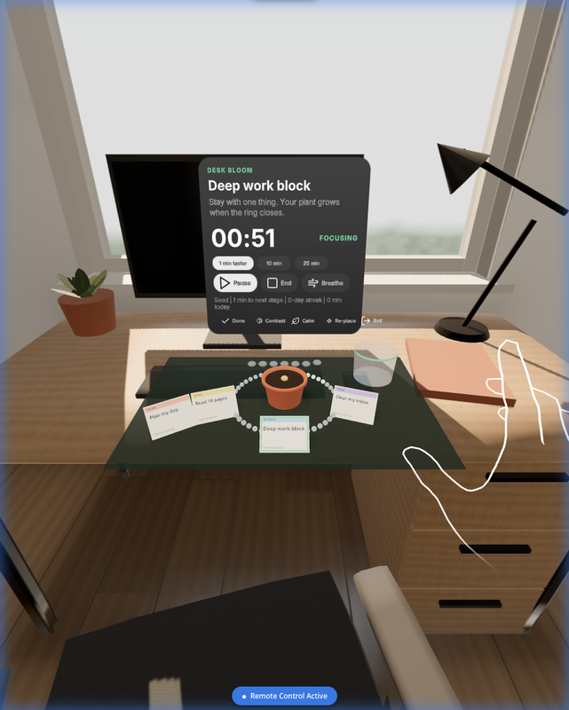
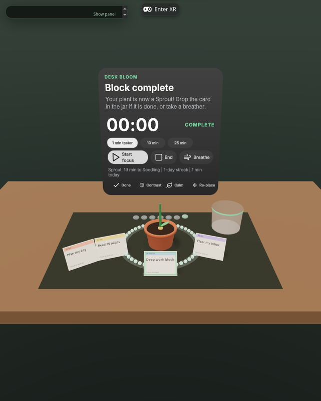
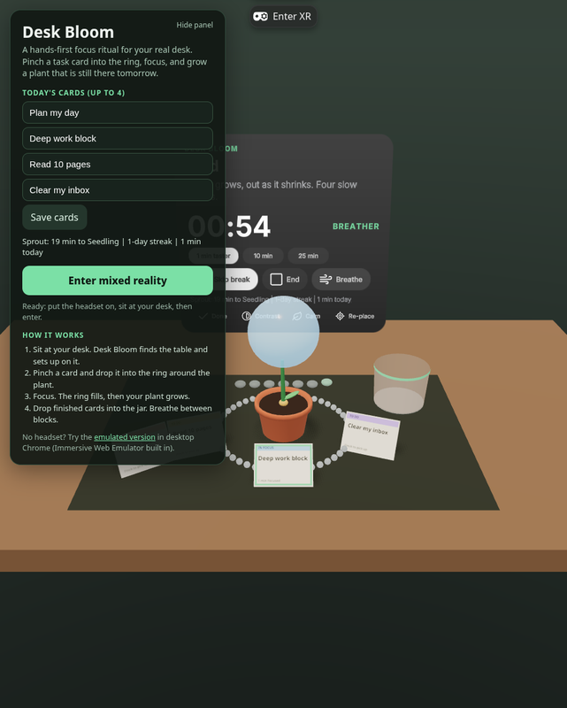

# Desk Bloom

**A hands-first mixed reality focus ritual for Meta Quest.** Sit at your real desk, pinch a task card, drop it into a ring around a little plant, and focus. When the ring closes, the plant grows. Built with the [Immersive Web SDK](https://github.com/facebook/immersive-web-sdk) (IWSDK) and WebXR.

- **Live (Quest Browser / any WebXR browser):** https://surajss11.github.io/desk-bloom/
- **Live, emulated (desktop Chrome, no headset needed):** https://surajss11.github.io/desk-bloom/emulator/
- **Track:** Productivity, New Experience (Meta VR Start Developer Competition 2026)

| Placed on the real desk | Focusing on one card |
| --- | --- |
|  |  |
| **Block complete, the plant grows** | **Breathing break with the orb** |
|  |  |

## The problem

Focus apps on a flat screen live in the same place as the distractions. Headsets could help, but most "productivity in VR" means virtual monitors that cut you off from your room, need controllers, and take minutes to set up. People who would benefit most (students, remote workers, people with ADHD) bounce off that friction.

Desk Bloom is a short, physical ritual that stays in your real room:

1. **Put the headset on at your desk.** Passthrough stays on. Desk Bloom finds your real table with scene understanding and sets a small kit on it: a mat, a pot, four task cards, and a done jar.
2. **Pinch a card and drop it into the ring.** That one card is your only job. The timer starts. There is no menu and no setup.
3. **Watch the ring close.** Beads light up as time passes. When the ring closes, the plant grows a stage (Seed, Sprout, Seedling, Sapling, Budding, Bloom, Full Bloom).
4. **Drop finished cards in the jar** and take a box-breathing break with the orb. Week stones show your streak, which gives you a reason to come back tomorrow.

The first run uses a **1-minute taster block**, so a new user sees the whole loop (place, pinch, focus, grow) inside their first minute.

## How it uses the platform

| Capability | How Desk Bloom uses it |
| --- | --- |
| **Hands first** | Everything works with bare hands: pinch-grab cards (`OneHandGrabbable`, `useHandPinchForGrab`), poke or hand-ray the panel buttons. Controllers work too, but they are optional. |
| **Passthrough with purpose** | Immersive AR session. The kit belongs on *your* desk, so the room stays visible and you can still reach your keyboard, coffee and notebook. |
| **Scene understanding** | Reads `XRMesh` (semantic labels `table`/`desk`/`counter`) and `XRPlane`. `chooseDesk()` picks the best seated-reach surface: 0.15–0.95 m below your eyes and at most 1.1 m away. If no table is found, it falls back to a comfortable spot in front of you. For 12 s after entering, placement upgrades itself when the room mesh arrives. **Re-place** recomputes it. |
| **FoV-aware layout** | `fovFromProjection()` reads the real field of view from the XR camera's projection matrix. The panel and the card arc are fitted to an ergonomic comfort zone (±30° horizontal, +15°/−35° vertical, tightened to 80% of the device FoV), so nothing ends up at the edge of the lenses. |
| **Seated and comfortable** | No locomotion. Everything is in seated reach. **Calm mode** turns off motion and sway, **Contrast mode** switches to a high-contrast palette, and the text sits large on a tilted panel. |
| **Fast cold start, pause and resume** | No large assets: the plant, ring, cards and props are procedural geometry, and sounds are synthesized with WebAudio. Losing visibility (headset off, system menu) auto-pauses. State is saved to `localStorage`, and a block that was interrupted comes back as *Paused*, with your time kept. |
| **Performance** | Instanced ring beads, a small canvas texture per card, and one shadowed key light. The frame `dt` is capped, and the timer follows the wall clock, so slow frames never stretch a block. |

## Architecture

```
src/
  core/            Pure TypeScript, no three.js or DOM. Fully unit-tested.
    session.ts     Focus/break/pause state machine, clamped ticks, revive-as-paused
    garden.ts      Growth stages, minutes, local-day streaks, last-7-days stones
    tasks.ts       Deck of up to 4 cards, single-focus rule
    breath.ts      Box-breathing (4-4-4-4) phase model
    fov.ts         FoV from projection matrix, comfort zone, arc layout
    desk.ts        Desk selection from scene-understanding surfaces + fallback anchor
    storage.ts     Safe localStorage wrapper with in-memory fallback
    app-state.ts   Reducer-style app actions, coach text, stats line, persistence
  visuals/         Procedural three.js: plant, progress ring, task cards, mat, jar, orb, petals
  systems/
    bloom-system.ts  The IWSDK ECS system: builds the kit, wires grab/drop and panel
                     buttons, does placement, lifecycle (blur => pause), persistence
  audio.ts         Tiny WebAudio synth for pick/drop/tap/bloom/breath cues
  page.ts          2D landing page: edit cards, see stats, enter mixed reality
public/ui/focus-panel.uikitml   Spatial UI panel (UIKitML, Horizon kit)
iwsdk.config.json               IWSDK project authority: AR, hand tracking, anchors,
                                plane + mesh detection, grabbing, spatial UI
scripts/build-pages.mjs         Builds native and emulator variants for GitHub Pages
tests/                          Vitest suites for everything in src/core
```

The app logic is a pure reducer (`AppState` with actions → new state + events). The ECS system only turns hand events into actions and renders the state, which keeps the behavior testable without a headset.

A test hook, `window.deskBloom` (`getState`, `dispatch`, `placement`, `setTitles`, `subscribe`), makes the app scriptable from automation and emulators.

## Run it

Requirements: Node 20+ (see `.nvmrc`) and npm.

```bash
npm install
npm run dev          # IWSDK dev server at https://localhost:8081 with the emulator injected
npm test             # 42 unit tests (Vitest)
npm run typecheck
npm run build:pages  # dist/ (native WebXR) + dist/emulator/ (IWER injected)
```

### Without a headset: Immersive Web Emulator (IWER)

- `npm run dev` injects IWER automatically on localhost, with an emulated **Meta Quest 3** in the **home_office** room, which has a real desk mesh.
- Or open the hosted build: https://surajss11.github.io/desk-bloom/emulator/ in desktop Chrome.

Steps:
1. Click **Enter mixed reality**.
2. Use the emulator overlay to switch to hands, move a hand over a card, pinch, drag the card over the ring and release.
3. Click the panel buttons with the emulated hand ray or controller.

You can also preview in a normal desktop browser without entering XR. The kit sits on a preview desk and the panel buttons work with the mouse.

### Meta XR Simulator / Immersive Web Emulator extension

- **Immersive Web Emulator** (Chrome/Edge extension): open the native build https://surajss11.github.io/desk-bloom/, choose a Quest 3 device in the WebXR devtools tab, and enter MR.
- **Meta XR Simulator**: open the native URL in a WebXR-capable browser connected to the simulator's OpenXR runtime, then load a synthetic room that has a desk so scene understanding has a table to find.

### On a Quest

Open https://surajss11.github.io/desk-bloom/ in the Meta Quest Browser while sitting at a desk, and press **Enter mixed reality**. Run Space Setup first, so the headset knows where your table is.

## Tests

`npm test` runs 42 Vitest tests over the pure core:
- Session timing, clamping, pause and revive.
- Growth stages and streaks across local days.
- The deck rules.
- Box breathing.
- FoV extraction and comfort-zone layout.
- Desk selection and fallback.
- Storage fallback.
- The full app reducer (first-run taster, focus → complete → jar, break, blur → pause, persistence round-trip).

## Accessibility

- Hands only, seated, and no locomotion.
- Large text, plus a high-contrast mode.
- Calm mode removes motion.
- Every gesture has a button equivalent (Done, Start, Breathe), so users with limited fine motor control can use ray or poke instead of grab-and-carry.

## License

[MIT](LICENSE). Built on the IWSDK starter template (MIT, Meta Platforms).
